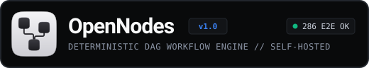

# Build and run AI workflows on your own infrastructure

OpenNodes is a visual workflow builder for connecting data sources, AI models, APIs and actions. Start with a template, edit the graph, check each step and publish a workflow that can run on a schedule or react to an incoming event.

[Interactive demo](https://dmsznv-dot.github.io/opennodes/) · [Download for macOS](https://github.com/dmsznv-dot/opennodes/releases/latest) · [Developer guide](./DEVELOPMENT.md) · [Русский](./README.md)

## What you can build

- **Briefings and digests.** Read an RSS feed, process new entries with an AI model and send the output to Telegram.
- **Scheduled reports.** Fetch data from an HTTP API, format it and deliver the result.
- **Tool-using agents.** Connect a model and selected tools from remote MCP servers over HTTP. Review calls and outputs in run history.

## Try it

The public demo simulates runs in the browser. To execute real workflows, install the macOS alpha on macOS 13.5 or later (Apple Silicon and Intel) or [run your own instance with Docker Compose](./DEVELOPMENT.md#3-self-hosted-docker-compose-deployment). The macOS distribution includes the engine and local database.

OpenNodes is a working alpha with an editor in Russian and English. [See releases](https://github.com/dmsznv-dot/opennodes/releases) or [share feedback](https://github.com/dmsznv-dot/opennodes/issues).
