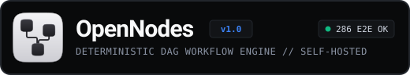

<p align="center">
  
</p>

<h1 align="center">OpenNodes</h1>

<p align="center">
  <strong>Self-hosted, deterministic visual workflow automation platform and DAG execution engine.</strong><br/>
  Built with crash-safe PostgreSQL journaling, AES-256-GCM envelope secret encryption, SSRF network defense, and an <strong>Unslop</strong>-engineered dark UI.
</p>

<p align="center">
  <a href="https://dmsznv-dot.github.io/opennodes/"><strong>🌐 Open the interactive UI demo on GitHub Pages →</strong></a><br/>
  <sub>The demo is a <strong>simulation</strong> running in your browser: it never calls real services and labels every result as an example. Real runs need your own Docker install.</sub>
</p>

---

## Key Capabilities (M1 Engine Slice + P0 Public Alpha MVP)

- **Visual DAG Editor & Real-Time Cycle Prevention**: Interactive canvas with typed ports (`trigger`, `json`, `string`, `number`, `boolean`, `binary`, `any`), Kahn's algorithm cycle detection (`ERR_CYCLIC_DEPENDENCY_DETECTED`), and a `480px` schema-driven Node Configuration Drawer.
- **Draft vs. Published Immutable Versioning**: Edit draft graphs freely without mutating active running workflows; publish immutable versions verified with permutation-invariant `SHA-256` checksums and one-click rollback.
- **4 Triggers + 6 Graph Primitives + 12 Connectors**:
  - **Triggers**: `Manual`, `Cron` (5-field + IANA timezone), `Incoming Webhook` (`HMAC-SHA256` + `X-Idempotency-Key` deduplication), `Telegram Polling` (`last_update_id + 1` offset persistence).
  - **Primitives**: `IF / Branch`, `Filter`, `Map`, `Durable Delay`, `ForEach`, `Merge`.
  - **Connectors**: `HTTP Request` (SSRF-guarded), `Outgoing Webhook`, `Cron`, `JSON Transform`, `CSV`, `RSS Reader`, `SMTP Email`, `PostgreSQL` (parameterized `$1, $2`), `Telegram Bot`, `Sandboxed Filesystem` (`ALLOWED_FS_ROOT`), `OpenAI Chat`, `Ollama Local LLM`.
- **Zero-Eval AST Expression Engine**: Safe `{{ $trigger.* }}` and `{{ $nodes.<id>.output.* }}` resolution via custom Lexer + Recursive-Descent Parser blocking `__proto__`, `constructor`, and `prototype`.
- **Enterprise Security & Observability**:
  - `AES-256-GCM` envelope encryption for workspace credentials with key rotation.
  - 4-role RBAC (`OWNER`, `ADMIN`, `EDITOR`, `VIEWER`) and one-time `/setup` instance bootstrap.
  - Real-time recursive `[REDACTED]` secret sanitization across logs, DB journals, and SSE streams.

---

## Public demo (GitHub Pages)

The demo in `docs/` follows a **simple-first** flow: *pick a task → connect a service → fill 2–5 clear fields → test → turn on*.

- **Home, Templates, Connections, History** — the graph editor is the second, advanced way in.
- **Readable steps**: actions instead of primitives ("Send a Telegram message"), status chips (*Needs setup / Ready / Error / Disabled*), data from earlier steps inserted as readable chips (`{Step 1: Message text}`) instead of raw `{{ $nodes… }}` expressions.
- **Honest simulation**: “Test” runs in the browser, says what *would* be sent, and fails with a clear reason when a step is not set up. Activation asks for confirmation and lists external actions.
- **RU / EN** switch available everywhere (including the first-run screen), light/dark/system theme, mobile layout with an overlay settings panel.
- **First-run tour** (4 steps, skip/resume/restart) built around a safe template with no external actions.
- **Developer mode** (profile menu) reveals node types/IDs, raw config JSON, graph checksum and manual connections with cycle validation.

Open it locally with any static server, e.g. `python3 -m http.server --directory docs`.

The **same editor is the real web app**: served by the OpenNodes web server (`apps/web`), it
switches to live mode (`/config.js`) — sign-in, data on the server, real tests and runs. See
*Run on this computer* below.

---

## Monorepo Architecture (13 Packages)

```text
opennodes/
├── assets/                 # Official OpenNodes SVG brand lockup & geometric icon mark
├── docs/                   # GitHub Pages UI demo — simulation only, RU/EN, no backend
├── apps/
│   ├── api/                # Control Plane REST API, SSE stream, Webhook ingress, RBAC & /setup
│   ├── worker/             # BullMQ Distributed Worker Daemon & Crash-Safe Resumption Engine
│   └── web/                # React Flow Visual Workflow Editor, 480px Config Drawer & Run Inspector
├── packages/
│   ├── shared/             # Error hierarchy, SSRFGuard (IPv4/IPv6/hex/decimal CIDR blocklist), SafeHttpClient
│   ├── ui/                 # Unslop Design System tokens (Ink/Graphite ramp, Electric Cobalt <2%, 4px grid)
│   ├── workflow-schema/    # Zod graph schemas, Kahn's cycle detector, SHA-256 permutation-invariant checksum
│   ├── db/                 # Drizzle ORM schema (18 PostgreSQL tables), SQL migrations & PGlite test harness
│   ├── auth/               # AES-256-GCM envelope encryption, key rotation, 4-role RBAC & /setup bootstrap
│   ├── observability/      # Structured Pino logger & recursive real-time [REDACTED] secret sanitizer
│   ├── connector-sdk/      # Typed ConnectorDefinition, ConnectorAction & ConnectorTrigger contracts
│   ├── workflow-engine/    # Zero-eval AST Expression Evaluator, 6 Graph Primitives, Topological Scheduler
│   ├── connectors-core/    # 4 Triggers (Manual, Cron, Webhook, Telegram) & 10 Core Connectors
│   └── connectors-ai/      # OpenAI Chat & Ollama Local LLM Connectors
├── infra/                  # Multi-stage Node 22 Alpine Dockerfiles (api, worker, web)
├── tests/                  # 286 E2E tests across Tier 1 (Features), Tier 2 (Boundaries), Tier 3 & Tier 4
└── docker-compose.yml      # 5-service production stack (postgres, redis, api, worker, web) with healthchecks
```

---

## Quick Start

### 1. Build, Typecheck & Run All Tests (Unit + 286 E2E)

```bash
pnpm install
pnpm build
pnpm typecheck
pnpm test
node tests/run-e2e.mjs
```

### 2. Run on this computer (no Docker, Postgres or Redis)

```bash
pnpm install
pnpm build
pnpm start:local
```

Open http://localhost:3000. The first visit asks you to create the owner account. Data lives in
`./.data` (embedded Postgres and the encryption key; never commit it). `WEB_PORT`, `API_PORT`,
`DATA_DIR` and the API's variables (e.g. `SSRF_ALLOWLIST=localhost:1234`) can be set in the
environment.

What the web app adds to the demo editor, in live mode:
- **Sign-in and first-run setup**; drafts are saved to the server as you edit.
- **“Test” runs the steps for real** (in the API, not recorded in history) and asks first when a
  step would send something outside; “Test step” runs a step with the steps before it.
- **Turn on** publishes the version and starts its trigger (schedule, Telegram, webhook);
  **Turn off** pauses it (webhooks answer `409`). Active schedules show their next run, bots show
  polling errors, webhook steps show their URL. Manual automations get a **Run** button.
- **Connections** are stored encrypted on the server (Telegram bot token, OpenAI key or a local
  model server) and can be checked (`getMe`, model list).
- **History** lists real runs from the server. Steps the server cannot run yet (email, external
  Postgres) and templates that use them are shown as planned.

### 3. Self-Hosted Docker Compose Deployment

```bash
cp .env.example .env
docker compose up -d --build
```

The web app is served on port 3000 and talks to the API through the same origin.

### How runs are executed

`POST /workflows/:id/execute` and incoming webhooks only **queue** a run (`202`, status `QUEUED`);
a worker executes it. Poll `GET /executions/:id` or the event stream for the result, or pass
`{ "wait": true }` to `execute` to get the finished run back (editor test runs).

- **`EXECUTION_MODE=queue`** (Docker Compose): runs go to Redis (BullMQ) and the `worker` service executes them. Scale by running more workers.
- **`EXECUTION_MODE=embedded`** (default, no Redis): the API runs an in-process queue and worker — the same code, for local runs and tests.

Guarantees, in both modes:
- **Delays are real.** Up to `INLINE_DELAY_MAX_MS` (5 s) the worker just waits; longer delays pause the run (`WAITING`), free the worker and resume on time — also after a restart.
- **A run is executed once.** Workers atomically claim a run in the database, so a job delivered twice (retry, recovery) does nothing the second time. Runs are never blindly retried, because steps may have side effects.
- **Crash recovery.** A running run heartbeats; if its worker dies, the run is re-queued and resumes after the last finished step, on the same branch.
- **Cancel works across processes.** `POST /executions/:id/cancel` stops a queued or waiting run, and a running one between steps.

### Schedules and Telegram messages

Publishing a workflow whose trigger is **On a schedule** (`trigger.cron`) or **New Telegram
message** (`trigger.telegram`) registers it; the worker (or the API in `embedded` mode) starts
the runs. Publishing a version with another trigger, or rolling back, updates or removes it.

- **Schedule** — config `{ "every": "every15m" | "hourly" | "daily" | "weekly", "time": "09:00", "timezone": "Europe/Moscow" }`,
  or any 5-field cron in `"cron"` (`@daily`, `0 9 * * 1-5`, …), evaluated in the IANA `timezone` (default `UTC`,
  daylight saving handled). `$trigger` = `{ scheduledAt, firedAt, timezone, cron }`.
  A run missed while nothing was running is skipped; set `"catchUp": "once"` to run it once instead.
- **Telegram** — select a `telegram` connection (`{ "botToken": "…" }`) on the trigger; optional
  `"onlyCommands": "/start, /ask"`. `$trigger` = `{ text, command, args, chatId, fromName, username, message, … }`.
  The bot is polled with `getUpdates`, so it must not have a webhook set. Messages sent before the
  trigger was published are ignored.
- **Each tick and each message starts exactly one run**, with several workers and across restarts:
  a schedule tick is claimed together with the run it creates, and a bot's update cursor advances
  in the same transaction that records its runs (only one process polls a bot at a time).
- `GET /api/v1/workflows/:id/triggers` shows the next and last run, the last run id and polling errors
  (e.g. a webhook still set on the bot); `PUT` the same path with `{ "enabled": false | true }` pauses
  or resumes it — resuming never replays what was missed.

### Posting to a Telegram channel from a feed

Template **RSS → AI → post to a Telegram channel**: a schedule reads a feed, AI writes the post, the bot publishes it.

- **Only new items.** With "Only items new since last run" (on by default) each feed item goes on
  once. Items are recorded when the run succeeds and released when it fails, so a failed post is
  retried, not lost. On the first run the feed's backlog is skipped. When nothing is new the steps
  below do not run (the run still succeeds). Tests from the editor do not use items up.
- **RSS fields:** `titles`, `digest` (title — link per line), `link`, `image` (enclosure,
  media:content/thumbnail or the first ``), `count`. CDATA and HTML entities are decoded.
- **Telegram:** the message step takes an optional picture link (the post becomes a photo with the
  text as its caption; a caption over 1024 characters follows as its own message) and
  "Disable link previews" now works. *Send a photo or file* sends a picture or document by link.
- The bot must be an **admin of the channel** allowed to post; use `@channel` or the `-100…` id.

### 4. Local models (Hugging Face GGUF, LM Studio, Ollama, llama.cpp)

OpenNodes does not run models itself. It calls a model server you run, over the
OpenAI-compatible API, so any model you downloaded can be a step in a workflow.

1. Start a server with the model you want:
   - **LM Studio:** download a model from Hugging Face in the app → *Developer → Start server* (`http://localhost:1234/v1`).
   - **Ollama:** `ollama pull hf.co/<user>/<repo>:Q4_K_M` (any GGUF on Hugging Face), then use `http://localhost:11434/v1`.
   - **llama.cpp:** `llama-server -hf <user>/<repo>:Q4_K_M --port 8080` (`http://localhost:8080/v1`).
   - Also works: Jan, vLLM, LocalAI.
2. Allow the API to reach it — local and private addresses are blocked by the SSRF policy by default:
   `SSRF_ALLOWLIST=localhost:1234` (from Docker: `host.docker.internal:1234`).
3. Add a connection of type `openai-compatible` with secrets
   `{ "baseUrl": "http://localhost:1234/v1", "defaultModel": "<model id>" }` (`apiKey` only if your server needs one).
   `GET /api/v1/workspaces/:id/credentials/:credentialId/models` checks the connection and lists the loaded models.
4. Use an `ai.openai` step with that connection: config `{ "prompt": "…", "system": "…", "model": "<optional>" }`.
   The reply is available to the next step as `{{ $nodes.<stepId>.output.text }}`.

If the server is down, the model is not loaded, or the address is not allowed, the step fails with the reason — it never reports a fake answer.
